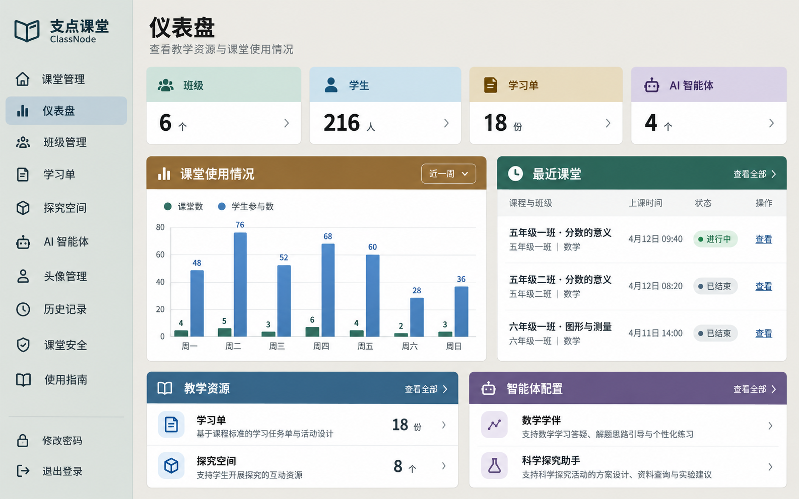
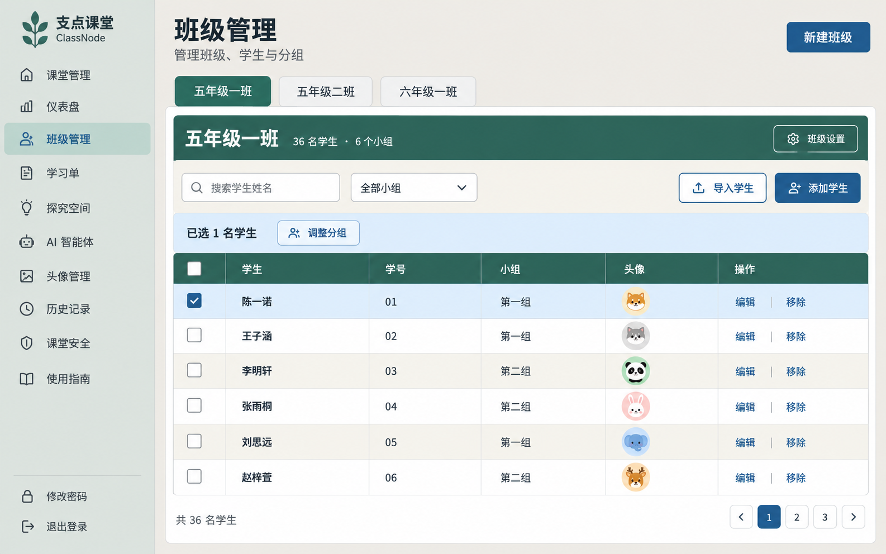
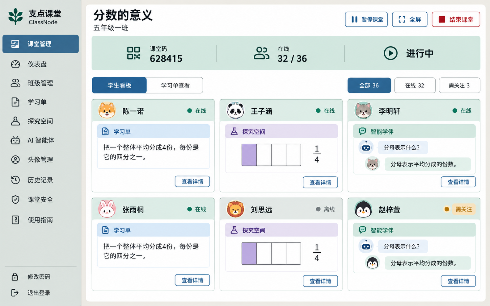
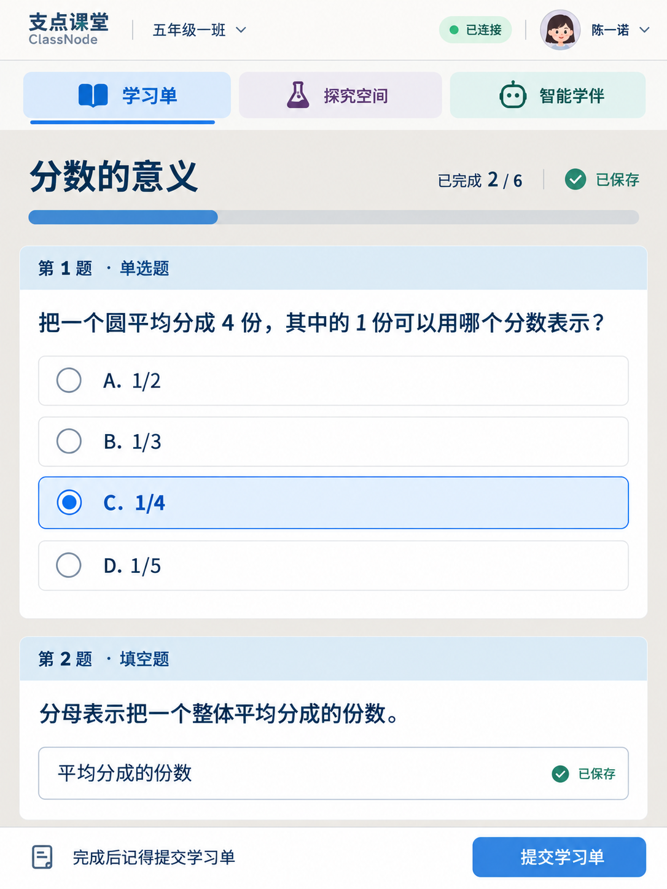

# 界面适配效果图 v1

生成方式：内置 image_gen；用途：设计评审。应用代码未修改。

四张效果图依次为教师仪表盘、班级管理、课堂看板、学生 iPad 竖屏学习单。图中数据、头像和品牌图形为设计示例，最终实现保留产品现有品牌资产与业务逻辑。生成稿呈现了深色标题栏这一较强对比的方向，可与浅色标题栏方向比较；具体字号与设备适配需浏览器验证。

## 01-teacher-dashboard.png



### 生成提示词

```text
Use case: ui-mockup. Produce ONE high fidelity, flat front-on Chinese web application UI screenshot, for 支点课堂 ClassNode, no laptop mockup, no photography, no perspective, no collage, no presentation framing. This is a design concept with illustrative data. Elegant practical educational software, readable medium-large Chinese sans serif (PingFang/Source Han Sans), consistent 16px-like body and navigation, 28px-like page titles, 14px-like supporting text, crisp legible Simplified Chinese. Clear medium contrast color regions, warm stone page background #ECEAE4, neutral gray-green sidebar #DDE2DE, white content, dark ink #26332F, secondary #52615A, visible borders #B5BDB7, primary solid blue buttons #315E7C. Category colors: teal dark #286757 on #D3E4DC, blue #315E7C on #D1E1ED, ochre #805D29 on #EADFC7, muted violet #655079 on #DED5E8. Restrained 10-12px corners, almost no shadows, no gradients, no glass, no tiny washed-out text, no display mode toggle, no decorative branding slogans. Strong clear spatial grouping; wide working area with 24px padding. Do not make every card a different random color. Landscape 16:10 desktop viewport. Teacher sidebar 224px wide, at left, brand "支点课堂" with small "ClassNode". Navigation vertically: "课堂管理", "仪表盘", "班级管理", "学习单", "探究空间", "AI 智能体", "头像管理", "历史记录", "课堂安全", "使用指南". Consistent line icons. Footer "修改密码", "退出登录".  Active nav "仪表盘". Main top title "仪表盘", subtitle "查看教学资源与课堂使用情况". Four compact KPI tiles in a single row, aligned: "班级" 6, "学生" 216, "学习单" 18, "AI 智能体" 4. Their bodies white with clear meaningful teal, blue, ochre and violet accent header bands. Below a two-column workspace: large ochre-header block "课堂使用情况" with a clean readable weekly bar chart, teal and blue bars, weekday labels; right teal-header block "最近课堂" showing 3 rows "五年级一班 · 分数的意义", "五年级二班 · 分数的意义", "六年级一班 · 图形与测量" with understated status badges and clear "查看" links. Bottom visible blue-header block "教学资源" listing "学习单 18", "探究空间 8" beside violet-header block "智能体配置" listing "数学学伴", "科学探究助手". Realistic coherent educational management dashboard, practical and crisp. All regions comfortably readable, no overflowing screen. Only exact supplied headings; use sensible concise Chinese for necessary labels.
```

## 02-teacher-classes.png



### 生成提示词

```text
Use case: ui-mockup. Produce ONE high fidelity, flat front-on Chinese web application UI screenshot, for 支点课堂 ClassNode, no laptop mockup, no photography, no perspective, no collage, no presentation framing. This is a design concept with illustrative data. Elegant practical educational software, readable medium-large Chinese sans serif (PingFang/Source Han Sans), consistent 16px-like body and navigation, 28px-like page titles, 14px-like supporting text, crisp legible Simplified Chinese. Clear medium contrast color regions, warm stone page background #ECEAE4, neutral gray-green sidebar #DDE2DE, white content, dark ink #26332F, secondary #52615A, visible borders #B5BDB7, primary solid blue buttons #315E7C. Category colors: teal dark #286757 on #D3E4DC, blue #315E7C on #D1E1ED, ochre #805D29 on #EADFC7, muted violet #655079 on #DED5E8. Restrained 10-12px corners, almost no shadows, no gradients, no glass, no tiny washed-out text, no display mode toggle, no decorative branding slogans. Strong clear spatial grouping; wide working area with 24px padding. Do not make every card a different random color. Landscape 16:10 desktop viewport. Teacher sidebar 224px wide, at left, brand "支点课堂" with small "ClassNode". Navigation vertically: "课堂管理", "仪表盘", "班级管理", "学习单", "探究空间", "AI 智能体", "头像管理", "历史记录", "课堂安全", "使用指南". Consistent line icons. Footer "修改密码", "退出登录".  Active nav "班级管理". Main title "班级管理", subtitle "管理班级、学生与分组", top right blue button "新建班级". Horizontal class tabs "五年级一班" selected teal, "五年级二班", "六年级一班". Large full-width white workspace with teal header band: "五年级一班" and "36 名学生 · 6 个小组", right outlined "班级设置". Below a neutral pale warm toolbar with search placeholder "搜索学生姓名", filter "全部小组", outlined "导入学生", blue "添加学生". Student table: colored teal header columns checkbox, "学生", "学号", "小组", "头像", "操作". Six comfortably tall rows with clearly legible Chinese sample names "陈一诺", "王子涵", "李明轩", "张雨桐", "刘思远", "赵梓萱", student codes 01-06, groups "第一组"/"第二组", small simple illustrated animal avatars, action text "编辑" and "移除". White and subtle warm alternating row fills, thin visible dividers. First row selected with pale blue fill and checked box; a compact selection bar "已选 1 名学生" and "调整分组" appears above table. Footer "共 36 名学生", pagination "1 2 3". Avoid excessively large blank regions; a clear usable warm teal educational workspace, consistent blue buttons.
```

## 03-teacher-classroom-board.png



### 生成提示词

```text
Use case: ui-mockup. Produce ONE high fidelity, flat front-on Chinese web application UI screenshot, for 支点课堂 ClassNode, no laptop mockup, no photography, no perspective, no collage, no presentation framing. This is a design concept with illustrative data. Elegant practical educational software, readable medium-large Chinese sans serif (PingFang/Source Han Sans), consistent 16px-like body and navigation, 28px-like page titles, 14px-like supporting text, crisp legible Simplified Chinese. Clear medium contrast color regions, warm stone page background #ECEAE4, neutral gray-green sidebar #DDE2DE, white content, dark ink #26332F, secondary #52615A, visible borders #B5BDB7, primary solid blue buttons #315E7C. Category colors: teal dark #286757 on #D3E4DC, blue #315E7C on #D1E1ED, ochre #805D29 on #EADFC7, muted violet #655079 on #DED5E8. Restrained 10-12px corners, almost no shadows, no gradients, no glass, no tiny washed-out text, no display mode toggle, no decorative branding slogans. Strong clear spatial grouping; wide working area with 24px padding. Do not make every card a different random color. Landscape 16:10 desktop viewport. Teacher sidebar 224px wide, at left, brand "支点课堂" with small "ClassNode". Navigation vertically: "课堂管理", "仪表盘", "班级管理", "学习单", "探究空间", "AI 智能体", "头像管理", "历史记录", "课堂安全", "使用指南". Consistent line icons. Footer "修改密码", "退出登录".  Active nav "课堂管理". Main classroom board top title "分数的意义", subtitle "五年级一班", at right outlined "暂停课堂", "全屏", dark-red outlined "结束课堂". Immediately below a clear teal header summary band: "课堂码 628415", "在线 32 / 36", "进行中". A neutral controls row: "学生看板" selected blue, "学习单查看"; filters "全部 36", "在线 32", "需关注 3". Main area uses 3-column x 2-row grid of student cards, all same white surfaces with teal thin header region, animal avatar and student name at 18px-like readable scale. Names "陈一诺","王子涵","李明轩","张雨桐","刘思远","赵梓萱". Each card shows exactly one module activity snapshot, no invented scores or rankings: blue small label "学习单" with a mini clear text response "把一个整体平均分成4份，每份是它的四分之一。"; violet label "探究空间" with a simple fraction rectangle visual; teal label "智能学伴" with 2 short dialogue lines "分母表示什么？" and "分母表示平均分成的份数。". Repeat module types among six cards. Some explicit badges "在线", one "离线", one amber "需关注". Bottom-right compact outlined "查看详情" per card. Clear real-time monitoring dashboard, functional, no huge charts, no dense unreadable tiny labels. Category colors align with student module color meaning blue worksheet, violet explore, teal companion.
```

## 04-student-worksheet-ipad.png



### 生成提示词

```text
Use case: ui-mockup. Produce ONE high fidelity flat front-on Simplified Chinese student web app UI screenshot in an iPad PORTRAIT 3:4 viewport, no physical device bezel, no perspective, no collage. Brand 支点课堂 ClassNode, calm welcoming learning workspace; crisp PingFang/Source Han Sans, large 18px-like question and option body, 16px status labels, 26px main heading, comfortable 48px touch targets. No tiny text. Page light warm neutral #ECEAE4, white question cards with blue #315E7C text and pastel blue #D1E1ED headers, teal #286757 accents, violet #655079 accents, visible soft borders, no shadows or gradients. At top TWO DISTINCT NAVIGATION ROWS, first contains small brand "支点课堂", "五年级一班", pill "已连接", student avatar and "陈一诺"; second contains three spacious tabs "学习单" selected blue, "探究空间" violet icon, "智能学伴" teal icon. Below the nav a worksheet heading "分数的意义" with readable progress "已完成 2 / 6" and save status "已保存". Below small clear horizontal progress bar. Content single column with generously spaced white question cards. Card 1 blue-tinted header "第 1 题 · 单选题", large prompt "把一个圆平均分成 4 份，其中的 1 份可以用哪个分数表示？", four full-width option rows with radio circles, "A. 1/2", "B. 1/3", "C. 1/4", "D. 1/5". Option C selected clearly in pale blue with strong blue outline, checked radio, bold answer label. Card 2 header "第 2 题 · 填空题", prompt "分母表示把一个整体平均分成的份数。", an accessible full-width input with student answer "平均分成的份数", small status "已保存". Bottom dock with readable "完成后记得提交学习单" and solid blue button "提交学习单". Student friendly but no childish decorations, no points scoreboard, no teacher sidebar, all text accurate and easy to read. This is a design concept, illustrative answers. Keep enough whitespace and show the entire UI without cutoff.
```

