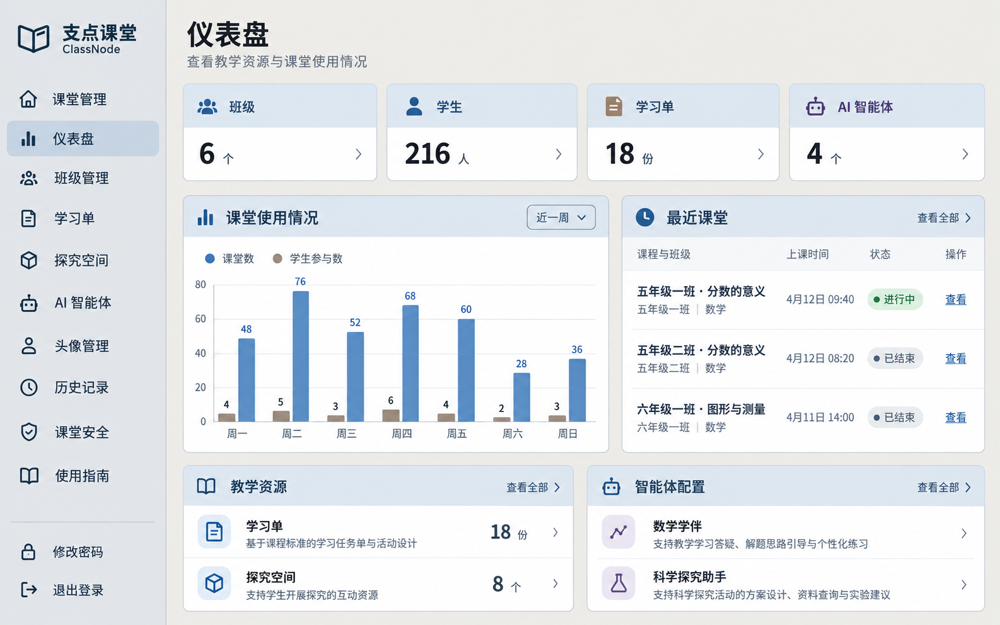
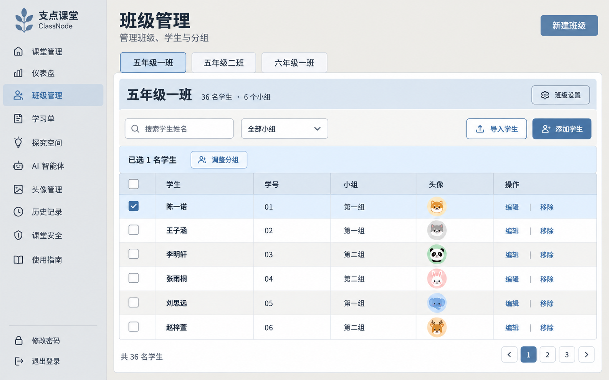
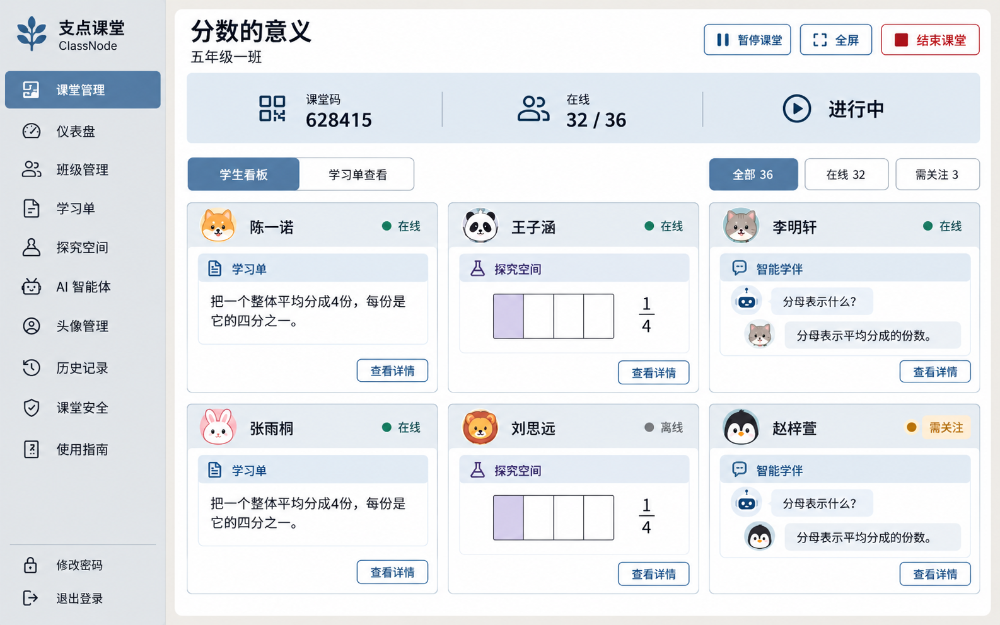
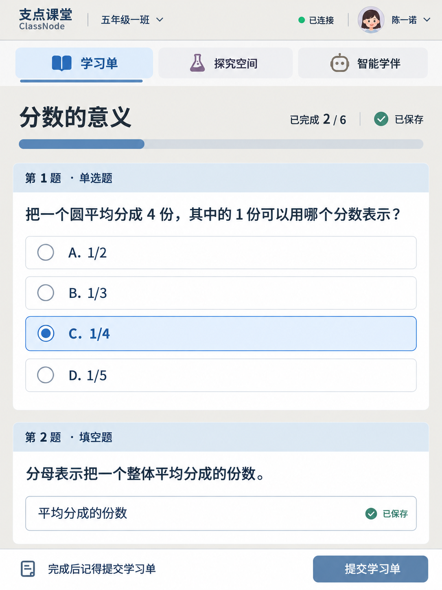

# 界面效果图 v3：暖灰与柔和蓝

使用内置 image_gen 基于 v1 修改，只调整配色；应用代码未修改。

用户反馈：保留布局与阅读方向，减少颜色和深色区域，不采用偏绿主题。当前候选为暖灰背景、浅蓝标题区、深色文字、柔和蓝主操作；淡紫和沙色限于少量图标与数据系列，绿色仅用于明确状态。v1 保留供对照，偏绿中间稿不作为当前候选。

## 01-teacher-dashboard.png



### 修改提示词

```text
Use case: ui-mockup edit. Edit the ONE referenced ClassNode screenshot into a refined lighter, less colorful visual design. User likes original layout but found colors too many and too dark; user explicitly DISLIKES GREEN tint. Preserve exact viewport, all layout, Chinese text, data, font sizes, spacing, controls, avatars and content. Only change color. A warm-neutral + soft muted BLUE scheme. Page background warm light gray #EEECE7 (stone, NOT beige-yellow), sidebar neutral #E5E7EA with absolutely NO green tint, white body #FFFFFF, dark neutral ink #293440, secondary #586574, visible border #B8C3CE. Main heading bands light powder blue #E1E8F0 and dark slate text, rather than dark filled bands. Primary buttons subdued blue #527495 and white text. Some minor warm sand #EDE6D9 and faint lavender #E9E4EE accents allowed only in small identifiers, not large multiple-colored sections. Large backgrounds must be neutral or light blue only. No sage, mint, teal or olive surface or text colors; green only small online/success status indicator. Never lighten body text or remove borders. Headings readable and region separation visible, not white-on-white. No gradients, no shadows, no added elements, do not shrink typography. Dashboard: FOUR KPI strips SAME light blue, dark slate labels and mostly muted blue icons; learning sheet small icon may use ochre sand, AI small icon muted lavender only. All main section header bands SAME light blue with dark neutral text and muted blue icons, remove dark ochre/green/purple bands. Chart series muted medium blue and taupe #9C8F7D, no teal. Keep data and positions identical.
```

## 02-teacher-classes.png



### 修改提示词

```text
Use case: ui-mockup edit. Edit the ONE referenced ClassNode screenshot into a refined lighter, less colorful visual design. User likes original layout but found colors too many and too dark; user explicitly DISLIKES GREEN tint. Preserve exact viewport, all layout, Chinese text, data, font sizes, spacing, controls, avatars and content. Only change color. A warm-neutral + soft muted BLUE scheme. Page background warm light gray #EEECE7 (stone, NOT beige-yellow), sidebar neutral #E5E7EA with absolutely NO green tint, white body #FFFFFF, dark neutral ink #293440, secondary #586574, visible border #B8C3CE. Main heading bands light powder blue #E1E8F0 and dark slate text, rather than dark filled bands. Primary buttons subdued blue #527495 and white text. Some minor warm sand #EDE6D9 and faint lavender #E9E4EE accents allowed only in small identifiers, not large multiple-colored sections. Large backgrounds must be neutral or light blue only. No sage, mint, teal or olive surface or text colors; green only small online/success status indicator. Never lighten body text or remove borders. Headings readable and region separation visible, not white-on-white. No gradients, no shadows, no added elements, do not shrink typography. Classes: class summary band and table header use light blue with dark slate text, selected class tab light blue plus medium-blue border, toolbar light neutral, selected row light blue with clear checked box. Primary buttons remain muted blue white text, avatar colors unchanged. No green theme anywhere.
```

## 03-teacher-classroom-board.png



### 修改提示词

```text
Use case: ui-mockup edit. Edit the ONE referenced ClassNode screenshot into a refined lighter, less colorful visual design. User likes original layout but found colors too many and too dark; user explicitly DISLIKES GREEN tint. Preserve exact viewport, all layout, Chinese text, data, font sizes, spacing, controls, avatars and content. Only change color. A warm-neutral + soft muted BLUE scheme. Page background warm light gray #EEECE7 (stone, NOT beige-yellow), sidebar neutral #E5E7EA with absolutely NO green tint, white body #FFFFFF, dark neutral ink #293440, secondary #586574, visible border #B8C3CE. Main heading bands light powder blue #E1E8F0 and dark slate text, rather than dark filled bands. Primary buttons subdued blue #527495 and white text. Some minor warm sand #EDE6D9 and faint lavender #E9E4EE accents allowed only in small identifiers, not large multiple-colored sections. Large backgrounds must be neutral or light blue only. No sage, mint, teal or olive surface or text colors; green only small online/success status indicator. Never lighten body text or remove borders. Headings readable and region separation visible, not white-on-white. No gradients, no shadows, no added elements, do not shrink typography. Classroom board: summary band light blue; ALL student name bands light neutral #ECEFF2 with dark ink names. ALL module strips use SAME light blue-gray #E7ECF2 and dark neutral titles. Only small module icons use muted blue for worksheet, faint lavender for explore, warm taupe for companion. Fraction shaded quarter faint lavender. Chat bubbles light neutral blue-gray; online indicators may stay green. Selected nav/tab/filter light blue with dark blue text. Dangerous end classroom still red outline. No green surfaces.
```

## 04-student-worksheet-ipad.png



### 修改提示词

```text
Use case: ui-mockup edit. Edit the ONE referenced ClassNode screenshot into a refined lighter, less colorful visual design. User likes original layout but found colors too many and too dark; user explicitly DISLIKES GREEN tint. Preserve exact viewport, all layout, Chinese text, data, font sizes, spacing, controls, avatars and content. Only change color. A warm-neutral + soft muted BLUE scheme. Page background warm light gray #EEECE7 (stone, NOT beige-yellow), sidebar neutral #E5E7EA with absolutely NO green tint, white body #FFFFFF, dark neutral ink #293440, secondary #586574, visible border #B8C3CE. Main heading bands light powder blue #E1E8F0 and dark slate text, rather than dark filled bands. Primary buttons subdued blue #527495 and white text. Some minor warm sand #EDE6D9 and faint lavender #E9E4EE accents allowed only in small identifiers, not large multiple-colored sections. Large backgrounds must be neutral or light blue only. No sage, mint, teal or olive surface or text colors; green only small online/success status indicator. Never lighten body text or remove borders. Headings readable and region separation visible, not white-on-white. No gradients, no shadows, no added elements, do not shrink typography. Student portrait: active worksheet tab light blue and muted-blue underline, other module tabs light neutral same background, small violet and warm taupe icon hints only; dark neutral text throughout. Question headers light blue with dark text. Selected option light blue with clear medium-blue border and checked radio. Submit button muted blue, progress medium blue. Save indicators small green status only; no teal text theme or green broad backgrounds. Preserve two-row nav, question content and touch sizes.
```

