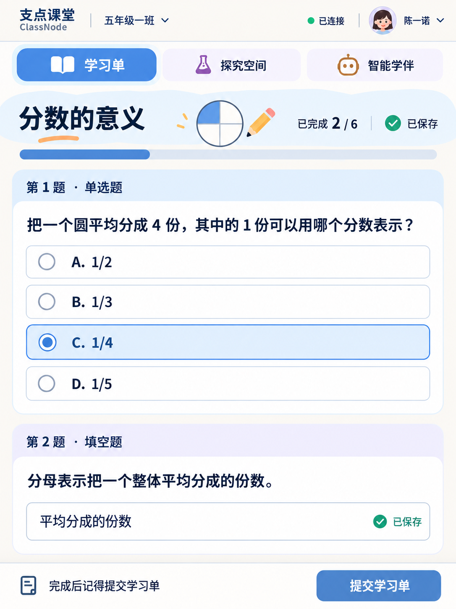

# 学生端独立风格效果图 v4

基于学生 iPad 学习单稿使用内置 image_gen 编辑。教师当前候选仍为 display-mockups-v3 中的教师三张稿。

面向小学、初中学生：明亮蓝色、浅紫、少量暖橙，柔和圆角、有限的课程插画与明确选中反馈；正文保持大字号、深色文字和白底。界面图为概念稿，应用代码未修改。



## 编辑提示词

```text
Use case: ui-mockup edit. Edit this referenced portrait student ClassNode learning worksheet screenshot into a DISTINCT, engaging student-facing style for Chinese primary school and middle school students. It should feel inviting and contemporary, age-inclusive, playful in small ways, not preschool or a business admin dashboard. Preserve the exact portrait viewport, all Chinese text, numbers, answers, existing navigation, question order, input, submission action, large readable typography and generous touch targets. No new functionality or fake reward points, rankings, streaks, stars or badges. Teacher style is irrelevant here: student interface can be more lively. Light airy ivory #FAF8F3 page with subtle pale lilac #F0EBFA and powder blue #E5F0FC, saturated but not neon medium blue #507FC7 for main actions and active state, lavender #8672AD and small apricot #E8B385 accents. NO green themed surfaces; only small saved/connected state icons may remain green. DARK ink #29344B body text, secondary #59677D, legible bordered cards. More rounded 18-22px question cards and 14-16px option rows; preserve font size or slightly improve readability. Header brand stays same. Two-row navigation: active worksheet a clear friendly blue rounded tab, inactive explore/companion predominantly neutral pale lavender/ivory with recognizable colorful icons, no huge dark fields. Main lesson heading "分数的意义" has a small tasteful fraction circle illustration at far right with exactly one of four quarters blue and small apricot pencil, keep progress and saved info visible and separated; this is the ONLY new decorative illustration. Do not add extra text or mascot figures. Question heading strips gently tinted blue/lilac and rounded corner treatment, crisp dark blue titles. All question content area white. Chosen option C clear blue border, lightly tinted blue, checked radio. Save indicators readable. Submit dock quiet ivory with medium blue round-corner primary button. Use solid surfaces, no gradients or glitter, no decorative busy patterns. Balance student appeal with readable school work. All Chinese characters accurately preserved. No physical iPad frame or perspective.
```

